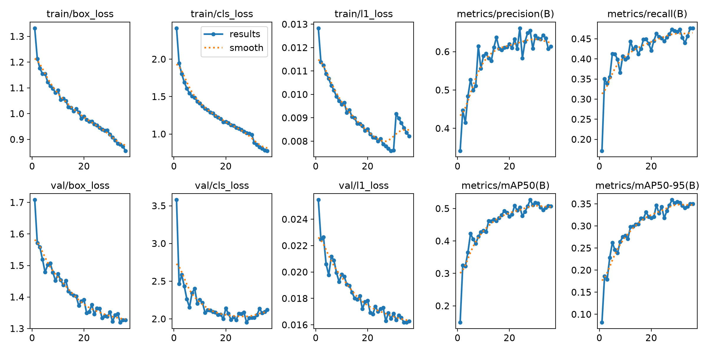
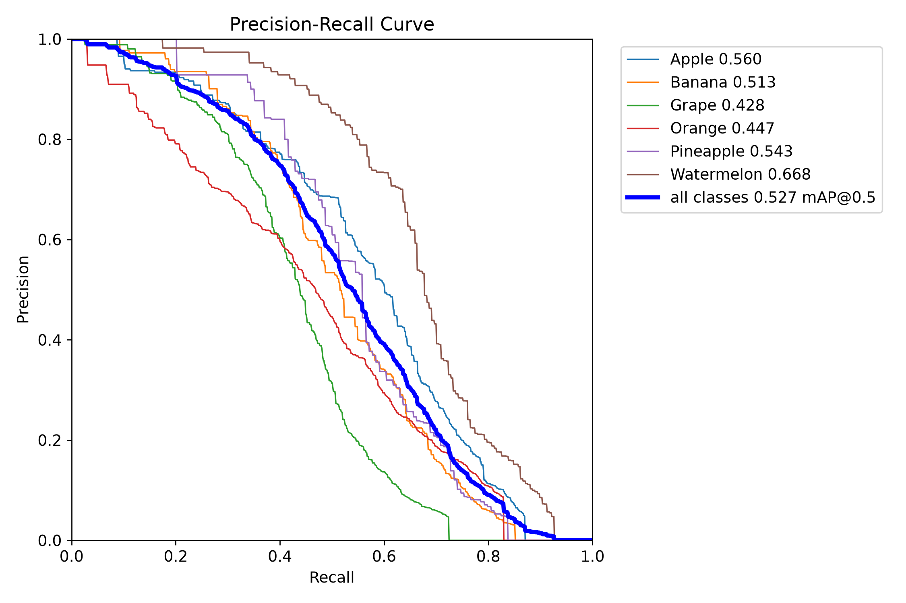

# fruit recognition
第二阶段考核任务
## 一些想说的话 
其实本来想做交通标志识别来着，不过找到的数据集里边的图太小了，加上训练用的设备也不怎么好，
导致训练了30轮map只有0.09，于是更换此项目，似乎有点老套，但是的确是自己的心血。
不过由于训练轮数过少（30轮），此项目的模型map只有0.5多一点，且对于连着的大量同类别物品容易识别
成一个。如果接着训练应该还能有一些提升。
## 数据集
数据集采用了https://github.com/lightly-ai/dataset_fruits_detection   
里边有六种水果。
## 本项目具体方案 
一共3个.py文件，train_yolo.py是模型的训练用的代码，reasoning_yolo.py是
使用训练好的yolo模型快速识别出框然后用SAM来精细的给出掩码，生成的图片分别放在了/output文件夹
和/output/traditional文件夹。  
use_model.py文件是调用大模型的结果的代码，其结果放在了answer.py文件中
具体的配置可以自己调整，目前代码里用的是deepseek flash模型
## 模型训练成果 

具体可以在runs/detect/TSv1-3中查看
## 使用说明
使用前一定要先在use_model里边把APIkey添上自己的，然后再使用。